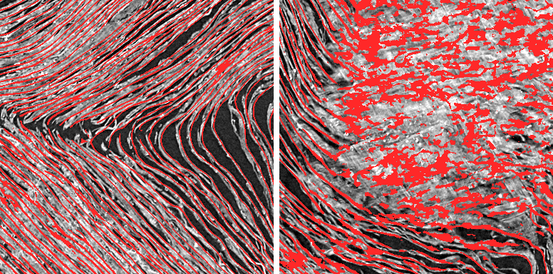

# First Letters scouting kit for the 8.64 µm (May 2025) scans: pre-registered, controlled, and run over all ten May volumes with two ink models

This kit searches the First Letters-eligible scrolls scanned at 8.64 µm / 116 keV (ESRF BM18, May 2025). It needs no
local copy of a volume: surfaces are grown, checked, rendered and read for ink straight from the public open-data
bucket. Every target readout is pre-registered, and the full chain is shown to read known text before its negatives
are reported.

**New on 24 October: a survey of all ten May volumes, read by two independent ink models.**
- **S1:** 87 zones were chosen mechanically from scouting, then grown and QC'd, with neighbouring windings in each
  volume's best zone. 108 surfaces (435.9 cm² of clean papyrus) on nine volumes were read with Hecate. The tenth,
  PHerc0490A, gave no surface that passed QC.
- **S2:** the same 108 surfaces were read again with reader-v2, an independent model with a much lower false-positive
  rate on blank papyrus.
- **Result:** no ink seen, and nothing met the pre-registered escalation rule. 182 of 216 surface reads were reviewed
  by eye (91 per model). 5 got "possible ink traces but no legible letters": 2 under Hecate, 3 under reader-v2, with
  PHerc0175A z8923_r55_a022 counted under both. None got "legible letters".
- **How long it took:** one rented g6.12xlarge (4× L4) for about 15 hours, from scouting to the second read.
  Everything, including the pre-registrations with their commit times and every verdict, is in this repository.

**Why this matters:**
- The two 2025-protocol scrolls that showed text, PHerc. 343 and PHerc. 1447, are May 8.64 µm scans. Four of the 21
  eligible volumes (PHerc0175B, 0483A, 0490A, 1218) had had only one shallow public ink pass.
- A "no ink" result is only worth something if the same chain, settings and threshold demonstrably find ink where it
  is known to exist. This kit makes that check part of the pipeline and publishes its numbers.
- A second, independent model is the test that one model's ambiguous rows and clouds need. The survey shows which
  responses both models agree on, and which only one model gives.

**The controls in brief (numbers only):**
- **PHerc0009B, published render:**
  - Hecate's depth ensemble scores AUC 0.941 against the organisers' labels (T = 0.445).
  - reader-v2 forward scores AUC 0.927 (validation 0.934), with T2 = 0.6275 flagging 1.55% of non-ink pixels.
- **PHerc0343:** a surface grown by this kit shows the October First Letters text line, a median of 2.9 voxels from
  the winner's mesh, under both models. In reader-v2, 93% of the text pixels sit within 0.3 mm of Hecate's.
- The controls were repeated on the survey machine before any survey surface was read.

Images that show readable letters are not published here, in keeping with the Vesuvius Challenge data agreement.

## What it contains
- **`m1/`: the search pipeline.**
  - A seed on the m7 surface prediction near a zone centre, plus neighbouring windings along the radial line
    (`seed.py`, `seeds_radial.py`).
  - VC3D GrowPatch, streaming the m7 prediction and its published normal grids, with no local volume copies
    (`grow_more.sh`).
  - Mesh QC: interior self-crossings and pairwise distinctness (`qc_meshes.py`), and the share of the readout area
    that sits on papyrus (`onpapyrus.py`).
  - A 48-layer render streamed from the masked CT, resampled to 9.604 µm (`resample_render.py`).
  - Hecate 9.6 µm in five depth windows and both directions, through a shared-GPU guard (`hecate_more.sh`).
  - A pre-registered readout (`readout.py`).
  - Review tools, for looking only:
    - review sheets, full-resolution crops and per-window depth views, with lines of constant z marking where text
      would run (`sheets.py`);
    - a check of whether a feature recurs on the neighbouring windings (`cross_winding.py`);
    - row tests along the text direction (`rowfind.py`, `zprofile.py`), depth tests (`depth_profile.py`,
      `depth_shift.py`), a void correlation (`voidcorr.py`) and a nearest-mesh check (`overlap.py`).
- **`m1/batch/`: the survey workers (S1).**
  - Mechanical zone choice from scouting (`m1/survey_select.py`).
  - Tracing workers that seed, grow, QC and queue surfaces (`survey_trace.sh`, `survey_stage2.sh`), and one Hecate
    worker per GPU that reads and triages them (`survey_gpu.sh`).
  - Pre-declared follow-up and row checks (`survey_followup.sh`, `survey_rowcheck.sh`).
- **`m2/`: the second read with reader-v2 (S2).**
  - Native render, three 17-layer depth windows per direction (`r2_infer.sh`), alignment to the S1 grid
    (`r2_combine.py`), readout with Hecate agreement (`readout_r2.py`) and triage (`triage_r2.py`).
  - One worker per GPU (`batch/s2_worker.sh`) and the controls (`control_job.sh`).
  - Looking aids: sheets, crops, a row test, a row finder and a row agreement check.
  - `setup_reader_v2.sh` installs reader-v2 and villa's ink-detection package in their own locked environment.
- **`e1/`, `e1b/`: positive controls on PHerc0009B.**
  - `e1b/`: a CT-only registration to the organisers' same-mesh labels (a pure shift).
  - `e1/`: the tools to move labels between two different meshes of one segment: depth search, tile field, and a dense
    non-rigid field.
- **`m1/control343_job.sh`: the end-to-end pipeline control.** It grows a surface of our own at the PHerc. 343 First
  Letters text, using the winner's published mesh only to choose the seed.
- **`e2/`: coarse scouting.**
  - Level-3 statistics per volume: on-CT papyrus and the share of m7 predictions that fall outside the CT.
  - Level-1 close-ups that rank zones by sheet separability.
- **`sweep/readout.py`:** candidate extraction and control calibration, with unit tests.
- **`prereg/` and `results/`:** every pre-registration and every verdict.

## Results (details in [docs/RESULTS.md](docs/RESULTS.md))
- **Survey of the ten May volumes (S1 with Hecate, S2 with reader-v2).** Verdicts are counted per model over surfaces
  reviewed by eye.

  | Volume | Surfaces read | Clean area (cm²) | Reviewed (S1 / S2) | "Possible traces" (S1 / S2) |
  |---|---|---|---|---|
  | PHerc0175A | 25 | 108.1 | 25 / 24 | 1 / 1 |
  | PHerc0175B | 6 | 19.1 | 6 / 5 | 0 / 0 |
  | PHerc0268 | 3 | 7.7 | 3 / 2 | 1 / 0 |
  | PHerc0306B | 15 | 66.0 | 14 / 14 | 0 / 0 |
  | PHerc0483A | 16 | 69.3 | 13 / 14 | 0 / 1 |
  | PHerc0483B | 11 | 41.7 | 5 / 10 | 0 / 0 |
  | PHerc0490A | 0 (4 zones failed QC) | 0 | — | — |
  | PHerc0490B | 2 | 4.9 | 1 / 0 | 0 / 0 |
  | PHerc0800 | 14 | 56.7 | 14 / 14 | 0 / 0 |
  | PHerc1218 | 16 | 62.4 | 10 / 8 | 0 / 1 |
  | **Total** | **108** | **435.9** | **91 / 91** | **2 / 3** |

  - Every other reviewed surface got "I didn't see any ink in the region." None got "I see legible letters."
  - The 5 "possible traces" verdicts cover 4 surfaces: PHerc0175A z8923_r55_a022 counts under both models.
  - The closest case is PHerc1218 z6974_r55_a067 under reader-v2.
    - 5 separate blobs run 5.4 mm along the text direction, and 61% of their pixels agree with Hecate. That meets the
      rule's numbers.
    - By eye they are round soft blobs in a field, not a line like the E1d text, which the rule also requires.
  - Both models agree on a few shapeless clouds, up to 18% of an area ≥ T2: PHerc0175A z6374_r30_a270 and PHerc0800
    zone z12149. These are the survey's strongest unexplained responses.
- **The positive control reproduces the published benchmark.** On PHerc0009B with the organisers' same-mesh labels,
  Hecate's −2..+2 depth ensemble scores **AUC 0.941** inside the supervision mask. J. Lu reported 0.956. The best single
  window scores 0.940 against his 0.954. Displaced-label nulls score 0.42–0.67. The threshold for all readouts,
  **T = 0.445**, comes from this control.
- **The 0009B labels in the Hugging Face bucket are on a different mesh.** The labels under
  `ink/0009b/..._inp_hr_2um` do not line up with the published 8.64 µm render by any scale and shift.
  - The best outline fit leaves texture NCC at 0.023, and AUC with that transfer is 0.746.
  - A CT-only dense field (1.7 px leave-one-out) brings it to 0.938 at the best window.
  - The open-data segment folder carries a same-mesh copy of the labels (`ink-labels/2.401um-.../20260918`), and that
    is the one to score against.
- **The pipeline control passes.** On PHerc0343, a GrowPatch surface seeded at the First Letters text area shows a
  line of glyph-like marks about 2 mm tall in the forward direction only.
  - The line lies on the winner's text sheet: a median of 2.9 voxels from their published mesh, at the text's height.
  - So the kit's own surfaces, render and threshold read real ink on a May 8.64 µm scroll.
- **Pre-registered negatives before the survey (22–23 October, Hecate on a shared A10G).** These are areas other teams
  can deprioritise or attack differently:

  | Volume | Surfaces read | Readout area | Verdict on every surface |
  |---|---|---|---|
  | PHerc0175B | 22: four zones (outer windings; mid-radius at z 7944; inner; outer far side) and three test zones | 80.8 cm² | "I didn't see any ink in the region." |
  | PHerc0490A | 21: the mid-radius zones at z 5848 (nine windings, then five more around one surface) and z 7600, and six test zones | 77.7 cm² | "I didn't see any ink in the region." |

  - In total: 43 surfaces, about 158.5 cm², in batches up to F3 (`results/M1-batch-*.md`, `results/PHerc*.md`).
  - Every counted surface sits on papyrus: 0.97–1.00 of its readout area by `m1/onpapyrus.py`. A PHerc0175B surface
    that grew off the papyrus (0.12) is not counted.

- **What it costs:**
  - **Shared A10G:** 6.5–13 cm² of readout area per GPU-hour (Hecate bf16, 5 windows × 2 directions, ≤ 1.8 GB). On
    the CPU, growth takes about 3–10 min and rendering about 1.5 min per 7.5 cm² surface.
  - **The survey on one g6.12xlarge** (4× L4, 48 vCPU):
    - Six tracing workers traced 127 surfaces in about 2 hours, about 5 min per zone for seed, growth, QC and render.
    - Hecate took about 2.6 min per run, so 4 L4s read about 40 cm² an hour; S1 used 47.2 L4-hours at 95%
      utilisation.
    - reader-v2, rendering included, read all 108 surfaces in 76 minutes.
- **Lessons from the survey:**
  - **A row of ≥ T blobs along the text direction is not evidence on its own.**
    - With Hecate, a simple row finder (`m1/rowfind.py`) finds rows on 29 of 108 survey direction-reads.
    - The same finder recovers the known E1d text line only weakly.
  - **Depth profiles don't separate ink from structure here.** Real text on our own meshes is as flat across the ±2
    windows as background (`m1/depth_profile.py`, `m1/depth_shift.py`).
  - **A second seed regrown nearby usually leaves the sheet in damaged papyrus.** It landed on a neighbouring winding
    in three of four checks. Re-read the same mesh with an independent model instead.
  - **The neighbouring-winding test is independent only when the neighbour lies more than about 12 voxels away.**
    Hecate's ±2 windows reach about ±11 voxels.
  - **reader-v2 is far quieter than Hecate.** Its median share is 0.8% ≥ T2, under its own control background of
    1.55%.
    - The two models agree mostly on a few shapeless clouds.
    - The useful test is agreement plus direction plus shape, as pre-registered for S2.
- **Earlier lessons:**
  - The level-1 separability score is necessary but not sufficient. Two PHerc0175B zones that passed it folded badly
    once grown: 8k–88k interior self-crossing quads, leaving only 0.2–2.6 cm² clean per 7.5 cm² surface. The
    self-crossing count after growth is the real gate (`m1/qc_meshes.py`).
  - Across the five scouted May volumes, 40–52% of m7 positives lie outside the CT (`e2/overview.py --scout`). Mask
    predictions to the CT before using them.
  - Hecate's response on PHerc0175B's outermost winding is diffusely raised (12% of the area ≥ T, against 1.2% on
    control background) without any stroke structure. It falls to 1–5% on the next three windings inward. Candidate
    counts are meaningless there. Read by eye, and use the one-sided test: ink shows in one direction, structure in
    both.
  - One-sided is not enough. Cracks give one-sided responses too: P8's streaks follow cracks in the CT and recur at the
    same 3D place on five windings. Ink would not repeat a whole turn away. Check the neighbouring windings
    (`m1/cross_winding.py`).
  - A surface can pass the self-crossing gate and still not be on papyrus. One test surface was 88% air. Check the
    papyrus share before reading (`m1/onpapyrus.py`).



*Level-1 close-ups of PHerc0175B at z 7944 (m7 prediction in red). Left: separated sheets with air gaps, where growth
works. Right: the crushed core.*

## Quickstart
```bash
bash setup.sh                          # venv + Hecate 9.6 µm (MIT) + VC3D AppImage (villa 406e767)
.venv/bin/python -m pytest tests       # readout rules and GPU guard

# 1) Positive control on PHerc0009B with the same-mesh labels (CPU registration, then GPU)
.venv/bin/python e1/fetch_control.py && bash e1b/fetch_labels.sh
.venv/bin/python e1/prepare.py --out data/e1     # 8.64 -> 9.604 um render.npy
bash e1b/job.sh                                  # writes data/e1b/register.json and score.json

# 2) Pipeline control on PHerc0343 (grow -> QC -> render -> Hecate -> readout)
bash m1/control343_job.sh

# 3) Search a zone: three windings per "NAME Z Y X CENTRE_Y CENTRE_X" (level-0 voxels)
bash m1/zones.sh "B 7944 3504 3862 4876 5234"
.venv/bin/python m1/qc_meshes.py --meshes data/m1/PHerc0175B/meshes --render data/m1/PHerc0175B/render \
    --out qc.json <mesh names>
.venv/bin/python m1/onpapyrus.py --sample PHerc0175B --volume-id 20250521125822 <mesh names>   # read only if >= 0.8
# write and commit prereg/<scroll>-<batch>.md, then:
PRE=prereg/<scroll>-<batch>.md bash m1/hecate_more.sh <mesh names>

# 4) Survey (S1): scout, choose zones mechanically, then trace and read with one worker per CPU slice / GPU
.venv/bin/python m1/survey_volumes.py            # the ten May volumes from the public catalogue
.venv/bin/python e2/zoom.py --sample PHerc0800 --volume-id 20250521135224 --z 12149 --angles 8 --out data/e2/zoom/PHerc0800_z12149_a8
.venv/bin/python m1/survey_select.py             # gate, exclusions, ranking -> data/m1/survey_zones.tsv
# commit prereg/M1-survey-S1.md (with the zone list), then e.g.:
RENDER_SCRATCH=/fast/disk bash m1/batch/survey_trace.sh 1 0-6 PHerc0175A PHerc0490B   # one per CPU slice
bash m1/batch/survey_gpu.sh 0 42-47 6                                                 # one per GPU

# 5) Second read (S2) with reader-v2 on the kept surfaces
bash setup_reader_v2.sh                          # reader-v2 (MIT) + villa ink-detection (MIT), own uv environment
bash m2/control_job.sh                           # E1b and E1d with reader-v2 first
# commit prereg/M1-survey-S2.md, queue data/s2/queue/ready/<sample>__<mesh>, then one worker per GPU:
bash m2/batch/s2_worker.sh 0 0-11
```
- **Settings:** every script takes its settings from `config.sh` and the environment: `CPUS`, `NICE`, `THREADS`,
  `GROW_THREADS`, `GPU`, `GPU_MIN_FREE_GB`, `GPU_MAX_OWN_GB`, `GPU_RESERVE_FILE`, `VC3D`, `HECATE_DIR`, `PY`, and for
  the survey `VC3D_CACHE`, `RENDER_SCRATCH`, `S2_SCRATCH` and `R2_DIR`.
- **Other scrolls:** set `SAMPLE` and `VOL` for `m1/grow_more.sh` and `m1/hecate_more.sh`, and `--prefix` for the seed
  tools.
- **Requirements:** Linux x86_64, Python ≥ 3.11, and a CUDA GPU with ≥ 8 GB free for Hecate. Disk use stays under
  about 20 GB, because the streamed caches are cleared after each step. Access to the open-data bucket in us-east-1
  costs nothing to read.
- **Formats:** OME-Zarr in, tifxyz meshes, zarr/`.npy` renders, PNG probability maps and JSON reports.

## How the readouts are kept honest
- **Pre-registration first.** Each batch is pre-registered in `prereg/` before any inference on it: target meshes,
  readout area, model and checksums, depth windows, ensemble, threshold, candidate rules, escalation rule and the
  fixed verdict sentences.
  - `m1/hecate_more.sh` refuses to run unless that file is committed and unmodified.
  - `m2/batch/s2_worker.sh` does the same for S2.
  - The pre-registrations were committed in our private lab repository. The files here are byte-identical copies,
    including their references to our private lab notebook (`docs/decisions.md`, which is not published).
  - The commits and the first use of each:

  | Pre-registration | Committed (UTC) | First use (UTC) |
  |---|---|---|
  | `prereg/PHerc0175B-m1.md` | 2026-10-22 02:42:36 | 02:42:36 (inference) |
  | `prereg/PHerc0175B-m1-b.md` | 04:42:18 | 04:42:19 |
  | `prereg/PHerc0175B-m1-c.md` | 08:27:38 | 08:27:39 |
  | `prereg/PHerc0175B-m1-d.md` | 12:18:37 | 12:18:38 |
  | `prereg/PHerc0490A-m1.md` | 18:26:30 | 18:26:30 |
  | `prereg/M1-batch-E.md` | 2026-10-23 03:07:42 | 03:07:43 |
  | `prereg/M1-batch-F1.md` | 04:42:15 | 05:47:19 |
  | `prereg/M1-batch-F2.md` | 06:26:52 | 14:19:46 |
  | `prereg/M1-batch-F3.md` | 06:54:45 | 17:03:20 |
  | `prereg/M1-survey-S1.md` and `M1-survey-S1-zones.tsv` | 22:41:18 | 22:50:11 (inference) |
  | S1 clarification: stage 2 starts from the best kept zone | 22:44:17 | before any QC row existed |
  | S1 deviation: follow-up check (labelled "01:50 UTC") | 2026-10-24 01:40:25 | 01:40:25 (growth of its check surfaces) |
  | S1 deviation: row-candidate check (labelled "04:10 UTC") | 03:52:17 | 03:52:18 (growth of its check surfaces) |
  | `prereg/M1-survey-S2.md` | 11:16:15 | 11:17:39 (first survey render for reader-v2) |
  | E1d pass criterion (in the lab notebook) | 2026-10-22 07:03:09 | 07:13:49 |

  - The two S1 deviation labels inside the pre-registration were approximate. The commit times above are
    authoritative, and each deviation was committed before any of the surfaces it concerns was grown.
  - The full private history is available to the Vesuvius Challenge team on request.
- **Verdicts are by eye**, and a candidate count never counts as a finding.
  - **Escalation before S2:** a candidate had to reappear under a second independent model or seed, in rows parallel
    to the horizontal fibres.
  - **Escalation in S2:** a reader-v2 row of separate blobs ≥ 5 mm along the text direction, like the E1d text line,
    with at least half of its pixels within 0.3 mm of Hecate's.
  - Surfaces with heavy self-crossing are reported as low-confidence geometry.

## Limitations
- **Two ink models, each with a narrow depth reach.**
  - Hecate reads ±2 layers around the surface; reader-v2 reads three 17-layer windows.
  - The PHerc. 343 winner averaged four models over 31 depths. A negative here is "not seen by this chain", not
    "no ink".
- **reader-v2's training includes PHerc0009B and PHerc0343 segments,** so its controls check the pipeline, not
  held-out ink.
- **GrowPatch patches,** about 7.5 cm² each, seeded zone by zone, not whole-winding spiral fits.
  - The 594 cm² read in all is a small fraction of each scroll.
  - Zones were chosen for clean sheet separation, which may not be where the writing is.
- **Unexplained responses:**
  - the outer windings' raised response on PHerc0175B;
  - the shapeless clouds that both models agree on (PHerc0175A z6374, PHerc0800 z12149).
  - They may be crust, voids, damage, or a surface that sits off the ink. The survey cannot tell which.

## Credits and licences
- **Code:** MIT (`LICENSE`). Data and third-party terms are in `NOTICE.md`.
- **Data:** scan data, labels and all derived images come from the Vesuvius Challenge open data, CC BY-NC 4.0 and the
  data agreement.
- **Tools and models:**
  - Hecate 9.6 µm and the m7 surface predictions are by the Vesuvius Challenge team.
  - reader-v2 (MIT) is DomRusso2's (github.com/DomRusso2/reader-v2; weights on Hugging Face as
    domenicor046/reader-v2).
  - It runs through the Vesuvius Challenge's ink-detection package `koine_machines` (ScrollPrize/villa, branch
    merge-ink-pipelines, MIT). `setup_reader_v2.sh` downloads both; nothing is copied in.
  - VC3D comes from ScrollPrize/villa (GPL-3.0, run as a program).
- **Prior work:**
  - The Hecate benchmark and depth-window analysis we reproduce are J. Lu's (ArcheyChen/vesuvius-eligible-scouting).
  - The PHerc. 343 mesh used to seed the pipeline control is E. Nieuwlaar's (Nieuwlaar/pherc343-first-letters).
